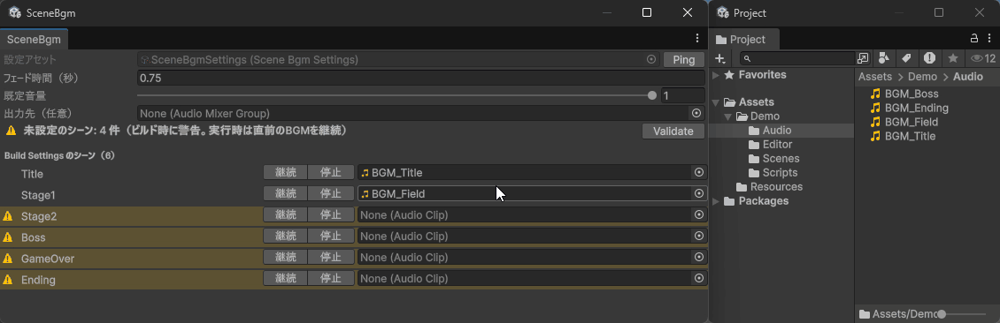
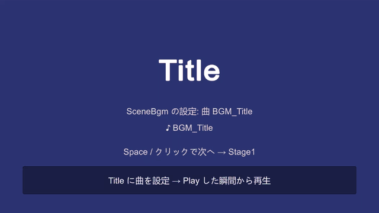
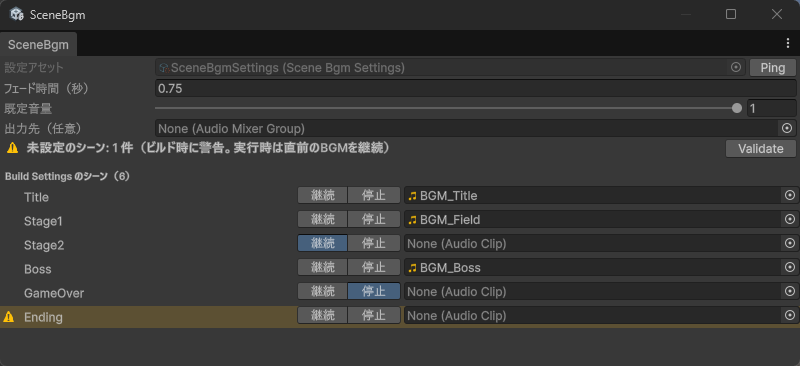
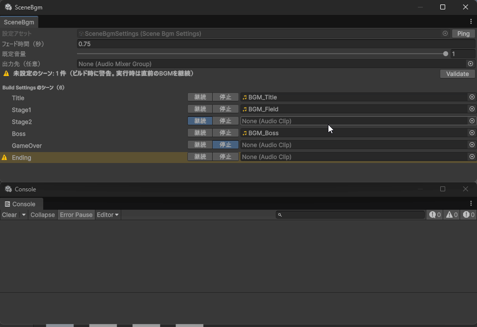

# SceneBgm

**English** | [日本語](README.ja.md)

**Still writing "keep the music playing across scenes" code for every project?**

SceneBgm is a Unity package that takes care of background music on scene changes. Open an editor window, pick
**[Continue] / [Stop] / a track (AudioClip)** for each scene in Build Settings, and you are done. Nothing needs to be placed in your scenes.

Set [Continue] / [Stop] with the buttons and drag tracks in; when the unset count reaches 0, you are done:



In Play mode, music crossfades on scene changes, [Continue] keeps the same track playing without a gap, and [Stop] fades out.
No BGM code is written in the scenes ([MP4 with sound](Documents~/playmode.mp4)):



## Every pitfall of the home-made version, handled

| Common pitfall | With SceneBgm |
|---|---|
| Your `DontDestroyOnLoad` music object multiplies every time you return to its scene, and the music plays twice | A single player is created automatically at startup. Nothing goes in your scenes |
| Pressing Play from a scene in the middle of the game gives you silence | Whichever scene you press Play in, that scene's setting is applied |
| Moving to a scene that uses the same track restarts it from the beginning | The same track keeps playing without a gap, from the same position |
| Writing your own crossfade is tedious | Automatic crossfade with one fade time shared by all scenes |
| Pausing (`Time.timeScale = 0`) freezes the fade, or `AudioListener.pause` silences the music too | Fades run on unscaled time, and the music ignores `AudioListener.pause` |
| "Keep the music in this scene" ends up scattered across per-scene scripts | Every scene is listed in one window, set them all there |
| You add a scene and forget to set its music | Unset scenes are highlighted in yellow and reported at build time |
| Moving or renaming a scene breaks its setting | Scenes are tracked by GUID, so settings stay attached |
| Saving and restoring the volume, again | Assign `SceneBgm.Volume` and it is saved and restored on the next launch |

- Requires: Unity 6000.3 or later
- Dependencies: none (built-in Unity features only)
- Namespace: `Kagami.SceneBgm` (editor extension: `Kagami.SceneBgm.Editor`)

A short summary for AI agents is in [AGENTS.md](AGENTS.md) (Japanese).

---

## Installation

### From a git URL (recommended)

In Unity, open **Window > Package Manager**, click **+** at the top left, choose **Install package from git URL...** and enter:

```
https://github.com/Kagami003d/SceneBgm.git#v1.0.0
```

Or add it to `dependencies` in `Packages/manifest.json`:

```json
"com.kagami003d.scenebgm": "https://github.com/Kagami003d/SceneBgm.git#v1.0.0"
```

`#v1.0.0` is a tag. Leave it out to get the latest commit on the default branch.

### As a folder (embedded package)

Place this repository (or the extracted release archive) in your project as `Packages/com.kagami003d.scenebgm/`.
No change to `Packages/manifest.json` is needed: Unity picks it up automatically and shows "SceneBgm" in the Package Manager.

The runtime assembly (`Kagami.SceneBgm`) is Auto Referenced, so `Assembly-CSharp` can simply use `using Kagami.SceneBgm;`.
If you use it from your own asmdef, add `Kagami.SceneBgm` to its references.

---

## Usage

> **Note:** the editor window and log messages are currently in Japanese. Label guide:
> 継続 = Continue, 停止 = Stop, 未設定 = Unset, フェード時間（秒） = Fade time (seconds), 既定音量 = Default volume,
> 出力先（任意） = Output (optional), 設定アセットを作成 = Create settings asset, 削除 = Delete,
> Build Settings に無い設定 = Settings not in Build Settings.

1. Open **Window > SceneBgm**.
   The settings asset `Assets/Resources/SceneBgmSettings.asset` is created the first time you open it.
2. At the top, set the **fade time (seconds)** (shared by all scenes, default 0.75), the **default volume** (used while no BGM volume has been saved yet, 0–1, default 1.0) and, if needed, the **output (AudioMixerGroup)**.
3. The list shows the Build Settings scenes in the same order. On each row, choose one of the following.



| Choice | What happens when the scene is entered |
|---|---|
| **[Continue]** | The current music keeps playing |
| **[Stop]** | The music fades out and stops |
| **An AudioClip in the BGM field** | Crossfades to that track (if it is already playing, nothing happens: no gap, no restart) |
| Nothing selected (unset) | The current music keeps playing, and **a warning is shown at build time** |

### The three choices are exclusive

- Only one of the three can be selected.
- Pressing [Continue] / [Stop] selects that mode and **resets the BGM field to None**.
- Putting a clip in the BGM field deselects [Continue] / [Stop].
- Setting the BGM field back to None makes the scene **unset**.
- Pressing the selected [Continue] / [Stop] again deselects it and makes the scene **unset**.

### Reading the window

- Unset rows show a warning icon on a yellow background, and the number of unset scenes is shown at the top.
- Scenes disabled (unchecked) in Build Settings are shown in grey. You can still set them, but they are not built, so they are not warned about.
- Hover over a scene name to see its path.
- Settings of scenes removed from Build Settings are kept, and come back when the scene is added again.
  You can review and delete them under "**Settings not in Build Settings (n)**" below the list (deletion can be undone).
- Changes are saved to the settings asset immediately (Undo / Redo supported).

### Moving and renaming scenes

Scenes are tracked by GUID, so moving or renaming a scene in the Project window does not break its setting
(the path used at runtime is updated on every move or rename, and also when the window is opened, before a build and on Validate).
Deleting a scene keeps its setting, and Validate reports it as "a setting whose scene cannot be found".

---

## Runtime behaviour

- When Play starts (before the first scene loads), a GameObject `[SceneBgm]` with two `AudioSource`s is created automatically and marked `DontDestroyOnLoad`.
  Nothing needs to be placed in your scenes. Whichever scene you press Play in, the setting of that first scene is applied.
- A scene's setting is applied when the scene is loaded with `LoadSceneMode.Single`. **Additive loads are ignored.**
- At runtime, settings are looked up by the scene's `Scene.path`.
- Fades advance with `Time.unscaledDeltaTime`, so they keep going at `Time.timeScale = 0` (pause menus etc.).
  The BGM `AudioSource`s use `ignoreListenerPause = true` (unaffected by `AudioListener.pause`) and loop.
- An `AudioSource` that has finished stopping gets `clip = null` to free streaming memory.
- No `AudioListener` is added (use your game's own).
- If there is no settings asset, a single warning is logged and only the per-scene automatic switching is skipped (no exceptions).
  The manual API (`Play` / `Stop` / `Volume`) still works (with the default fade time of 0.75 seconds).
- With Enter Play Mode options (domain reload disabled), no state is carried over from the previous session.

---

## Public API

```csharp
using Kagami.SceneBgm;

SceneBgm.Play(clip);            // Crossfade with the shared fade time. Does nothing if the same track is playing. null acts as Stop
SceneBgm.Play(clip, 0f);        // Explicit fade time (0 switches instantly)
SceneBgm.Stop();                // Fade out and stop
SceneBgm.Stop(1.5f);

SceneBgm.Volume = 0.5f;         // Clamped to 0–1. Applied immediately, saved to PlayerPrefs, raises VolumeChanged
SceneBgm.VolumeChanged += v => slider.SetValueWithoutNotify(v);
SceneBgm.SetVolumeMultiplier(0.3f); // Unsaved internal multiplier (ducking etc.). 0–1

AudioClip current = SceneBgm.CurrentClip; // The track that "should" be playing (excluding one fading out). null when stopped
bool playing = SceneBgm.IsPlaying;
SceneBgmSettings settings = SceneBgm.Settings; // The loaded settings (null if none)
```

| Member | Description |
|---|---|
| `Play(AudioClip clip, float? fadeSeconds = null)` | Play manually (looped). If `fadeSeconds` is null, the shared fade time from the settings is used |
| `Stop(float? fadeSeconds = null)` | Fade out and stop |
| `Volume` | User volume, 0–1. Saved to the `PlayerPrefs` key `SceneBgm.VolumePrefsKey` (`"Kagami.SceneBgm.Volume"`). With no saved value, the settings asset's **default volume** (`SceneBgmSettings.DefaultVolume`) is used, or `SceneBgm.DefaultVolume` (1.0) if there is no settings asset. Assigning the current value still saves it if it was not saved yet |
| `VolumeChanged` | Raised when `Volume` changes (`Action<float>`, the clamped value) |
| `SetVolumeMultiplier(float)` / `VolumeMultiplier` | Unsaved internal multiplier (default 1) |
| `CurrentClip` / `IsPlaying` | The current track / whether music is playing |
| `Settings` | The loaded `SceneBgmSettings` (null if none) |

- Final volume = `Volume` × `VolumeMultiplier` × fade factor
- `PlayerPrefs.Save()` is not called on every change but once, 0.5 seconds after the last change.
  It is always called when the app is paused, loses focus or quits.
- **Even after a manual `Play`, the next scene load follows the settings** (in a [Continue] or unset scene, the manually started track keeps playing).
  To start music manually in the first scene, call it from `Start` or later, not `Awake` (`Awake` runs before the scene's setting is applied and would be overridden).

---

## Build-time warnings and Validate



- Before a build, every **enabled Build Settings scene that is unset** is reported with its path via `Debug.LogWarning` (one line per scene plus a summary line).
  **The build is not stopped.** If there is no settings asset, a single warning is logged.
- The same check runs from the **Validate button** in `Window > SceneBgm`. If there are no problems, a Log message is shown (unset rows are also highlighted in the window).
- Batch mode (for CI or AI verification):

```
Unity.exe -batchmode -projectPath <project> -executeMethod Kagami.SceneBgm.Editor.SceneBgmValidator.RunBatch -logFile <log>
```

  Unset scenes produce warnings with **exit code 0**. Only a missing or unreadable settings asset gives **exit code 1**.

---

## Settings asset

- The location is fixed at `Assets/Resources/SceneBgmSettings.asset` (it is read with `Resources.Load` at runtime).
  **Do not put it inside the package** (package updates would delete it). The window warns you if it is somewhere else.
- The Inspector shows only an overview and an "Open window" button. Edit settings in the window.
- Inconsistencies (such as a clip on a [Continue] / [Stop] entry) are fixed automatically on load and on edit.

---

## Limitations

- There is one BGM channel (crossfading between two `AudioSource`s). There is no SE support, no playlist / shuffle and no intro + loop.
- There is no per-track volume or loop setting (always looped, volume is `Volume` × multiplier).
- Settings of additively loaded scenes are not used.
- The editor UI and log messages are in Japanese only.
- There is only one settings asset (`Assets/Resources/SceneBgmSettings.asset`).
- Runtime matching uses the scene path. Paths do not change after a build, but if you move a scene outside the editor (e.g. in Explorer),
  the path is updated the next time Unity imports it (or when the window is opened, or before a build).

## Tests

Unity Test Framework tests are in `Tests/Editor` (EditMode) and `Tests/Runtime` (PlayMode, with three empty test scenes).
Run them from `Kagami.SceneBgm.Editor.Tests` / `Kagami.SceneBgm.Tests` in the Test Runner.

When installed from a git URL, package tests do not show up in the Test Runner by default. Add the following to `Packages/manifest.json` (not needed for an embedded package):

```json
"testables": [ "com.kagami003d.scenebgm" ]
```

## Changelog

See [CHANGELOG.md](CHANGELOG.md) (Japanese).

## License

[MIT License](LICENSE.md)
